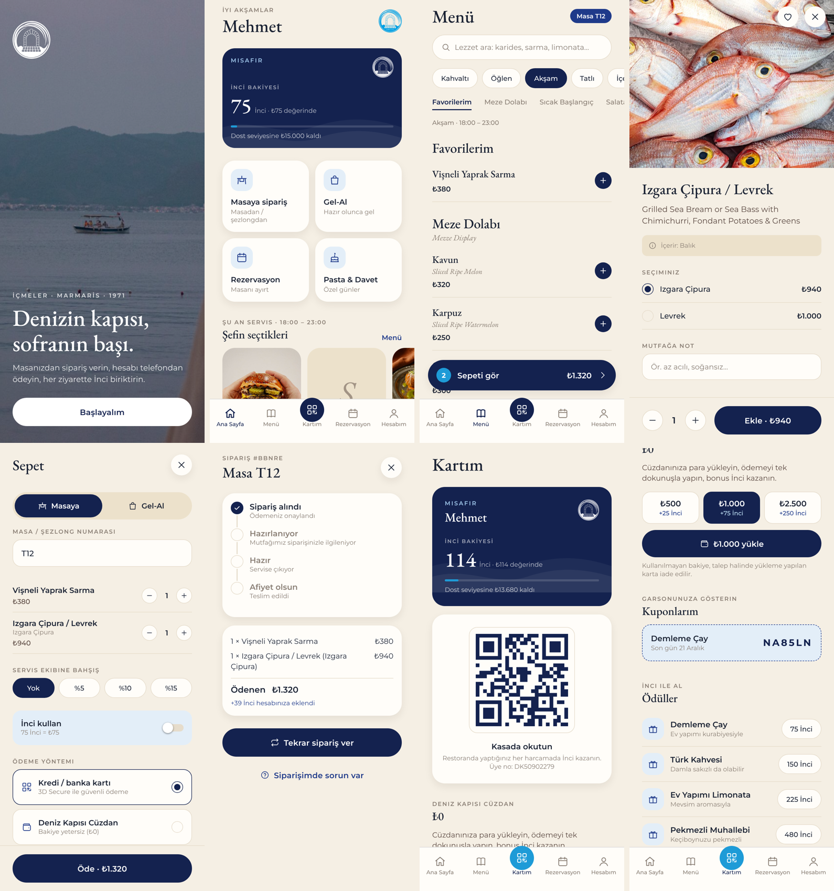

# Deniz Kapısı — Mobil Uygulama

İçmeler / Marmaris'teki **Deniz Kapısı Restaurant & Bar** (1971'den beri) için iOS ve Android uygulaması.
Sadakat programı (İnci), masaya / şezlonga ve gel-al sipariş, uygulama içi ödeme, cüzdan, rezervasyon ve pasta/davet talebi içerir.

Expo (React Native) + TypeScript + Expo Router ile yazıldı. Tek kod tabanından iOS, Android ve web çıkar.

## Ekranlar



| Sekme / Ekran | İçerik |
|---|---|
| **Karşılama** | Marka girişi, ad ve telefon ile kayıt, SMS kodu (demo kod: `1971`) |
| **Ana Sayfa** | Selamlama, İnci kartı, hızlı işlemler (Masaya sipariş, Gel-Al, Rezervasyon, Pasta & Davet), aktif sipariş, şefin seçtikleri, hikâye, iletişim |
| **Menü** | Saate göre açılan servis (Kahvaltı / Öğlen / Akşam / Tatlı / İçecek), bölüm sekmeleri, arama, alerjenler |
| **Ürün** | Fotoğraf, TR/EN açıklama, alerjenler, seçenekler (ör. yumurta çeşidi, bonfile sosu), mutfağa not, adet |
| **Sepet** | Masaya / Gel-Al, masa numarası veya teslim saati, bahşiş, İnci kullanımı, kart veya cüzdan ile ödeme |
| **Sipariş takibi** | Alındı → Hazırlanıyor → Hazır → Teslim |
| **Kartım** | İnci bakiyesi, seviye ilerlemesi, kasada okutulan **30 saniyede bir yenilenen QR**, cüzdan yükleme (+bonus İnci), ödüller, seviyeler, hareketler |
| **Rezervasyon** | 14 günlük takvim, saat, kişi, alan (deniz kenarı / teras / bahçe / iç mekan), özel gün |
| **Hesabım** | Siparişler, pasta & davet, hikâye, yol tarifi, iletişim, Spotify, yasal metinler |

Menünün tamamı **dkmenu.com.tr**'deki güncel QR menüden (01.06.2026 tarihli) alındı: 200'ün üzerinde ürün, fiyat ve alerjen.

## Çalıştırma

```bash
npm install
npx expo start          # QR'ı telefondaki Expo Go ile okutun
npx expo start --web    # tarayıcıda
npm run typecheck
```

## Klasör yapısı

```
src/
  app/            Ekranlar (Expo Router: her dosya bir ekran)
    (tabs)/       Alt menü sekmeleri
  components/     Ortak arayüz bileşenleri (Icon, MemberCard, ProductRow, CartBar, ui)
  config/         Restoran bilgileri, İnci seviyeleri, ödüller, yükleme seçenekleri
  data/           Menü verisi (menu.generated.json + düzeltmeler: menu.ts)
  services/       auth (SMS OTP) ve payment (iyzico/PayTR). Şu an demo modunda
  store/          Uygulama durumu (zustand, cihazda kalıcı)
  theme/          Renkler, yazı tipleri, boşluklar
scripts/parse-menu.py   QR menü metnini uygulama verisine çevirir
docs/                   Rakip analizi ve yol haritası
```

## Menü güncelleme

Backend gelene kadar menü `src/data/menu.generated.json` dosyasından okunur. dkmenu.com.tr değiştiğinde sayfaların metnini alıp
`python3 scripts/parse-menu.py <metin_klasörü> > src/data/menu.generated.json` komutunu çalıştırın.
Fotoğraf eşleştirmeleri ve elle eklenen ürünler (çocuk menüsü, günün balığı, sos seçenekleri) `src/data/menu.ts` içindedir.

## Durum

Arayüz ve akışların tamamı çalışıyor. **Demo** olan kısımlar: SMS doğrulama, kart ödemesi ve verilerin sunucuya kaydı.
**Plaj pilotu** (şezlongdan sipariş, personel paneli, QR ile puan) için: [docs/PLAJ_PILOTU.md](docs/PLAJ_PILOTU.md). Şezlong QR kartları: `node scripts/sezlong-qr.js 1 40 > sezlong-qr.html`.

Yayına çıkış adımları için: [docs/YOL_HARITASI.md](docs/YOL_HARITASI.md). Rakip incelemesi için: [docs/RAKIP_ANALIZI.md](docs/RAKIP_ANALIZI.md).
